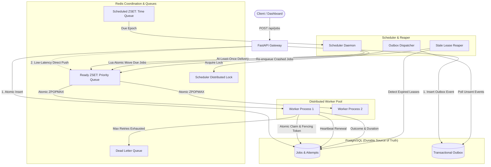
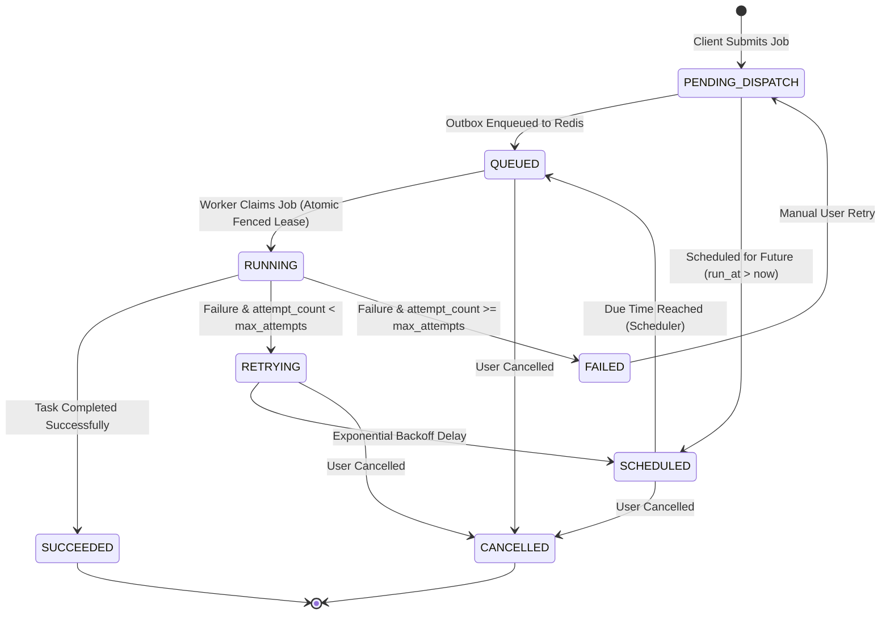

# TaskFlow: Distributed Task Queue & Job Scheduler

[](https://github.com/example/taskflow/actions/workflows/ci.yml)
[](https://www.python.org/downloads/)
[](https://fastapi.tiangolo.com/)
[](https://www.postgresql.org/)
[](https://redis.io/)
[](https://opensource.org/licenses/MIT)

**TaskFlow** is an asynchronous, distributed background task processing engine and job scheduler built with Python, FastAPI, PostgreSQL, and Redis. It provides reliable queue semantics, priority dispatching, distributed leases with fencing tokens, automatic crash recovery, exponential backoff with jitter, and a lightweight web dashboard.

---

## Architecture Overview



---

## Job State Machine Lifecycle



---

## Key Features

1. **Transactional Outbox Pattern**: Prevents dual-write inconsistencies between PostgreSQL and Redis. Every job is committed to PostgreSQL with an outbox event before queue delivery, guaranteeing at-least-once enqueueing.
2. **Distributed Leases & Fencing Tokens**: Workers obtain a timed lease (`lease_expires_at`) and fencing token (`lease_token`). If a worker hangs or experiences an extended pause, zombie writes are safely rejected by the database.
3. **Crash Recovery (Stale Lease Reaper)**: If a worker node crashes or disconnects, the scheduler detects expired leases and reclaims abandoned work without human intervention.
4. **Strict Priority Scheduling & FIFO Tie-Breaking**: Implemented via a 64-bit Redis Sorted Set (`ZSET`) score combining user priority and arrival epoch.
5. **Exponential Backoff with Jitter**: Protects downstream dependencies from synchronized thundering-herd retry storms using truncated exponential backoff with $\pm 20\%$ uniform jitter.
6. **Task Handler Registry**: Enforces security invariants by restricting execution to explicitly registered, sandboxed handlers (`simulate_report`, `process_text`, `simulated_failure`, `sleep_task`, `send_notification`). Arbitrary shell or code execution is strictly prohibited.
7. **Idempotency Protection**: Client-provided `idempotency_key` ensures repeated submissions return the existing job rather than duplicating tasks.
8. **Real-Time Web Dashboard**: Polished dark-mode monitoring interface with live queue metrics, job inspection modal, attempt timeline, and cancellation/retry controls.

---

## Quickstart & Local Setup

### Option 1: Docker Compose (Full Stack with PostgreSQL & Redis)

1. Clone repository and create configuration:
   ```bash
   cp .env.example .env
   ```

2. Start the entire cluster (API, Workers, Scheduler, PostgreSQL, Redis):
   ```bash
   docker compose up --build
   ```

3. Open the dashboard and API documentation:
   - Web Dashboard: [http://localhost:8000](http://localhost:8000)
   - Interactive Swagger API Docs: [http://localhost:8000/docs](http://localhost:8000/docs)

---

### Option 2: Standalone Local Development (Without Docker)

TaskFlow includes an embedded fallback mode using SQLite (`aiosqlite`) and in-memory `fakeredis`, allowing immediate development and testing on any machine without installing Docker or database daemons.

1. Create and activate a Python virtual environment:
   ```bash
   python -m venv .venv
   .\.venv\Scripts\Activate.ps1  # Windows PowerShell
   # or: source .venv/bin/activate (Linux/macOS)
   ```

2. Install dependencies:
   ```bash
   pip install -r requirements.txt
   ```

3. Run all services in a single development process:
   ```bash
   python scripts/run_dev.py
   ```
   This automatically runs the FastAPI server, Worker node, and Scheduler concurrently.

4. In a second terminal, seed sample jobs:
   ```bash
   python scripts/seed_jobs.py
   ```

---

## Running the Automated Test Suite

TaskFlow comes with a comprehensive test suite (34 unit & integration tests) covering state transitions, atomic claiming, priority ordering, retries, dead-letter routing, and API contracts.

```bash
# Run tests with pytest
pytest -v

# Run lint and formatting checks with Ruff
ruff check .
ruff format --check .
```

---

## REST API Reference

### 1. Submit a Job
`POST /api/jobs`

**Request:**
```json
{
  "task_type": "simulate_report",
  "payload": {
    "rows": 1000,
    "report_type": "quarterly_revenue"
  },
  "priority": 5,
  "max_attempts": 3,
  "idempotency_key": "q3_revenue_report"
}
```

**Response (201 Created):**
```json
{
  "id": "e93a61f2-7634-4361-9c12-3c13880629a8",
  "task_type": "simulate_report",
  "payload": { "rows": 1000, "report_type": "quarterly_revenue" },
  "status": "QUEUED",
  "priority": 5,
  "created_at": "2026-10-18T20:20:00.000000Z",
  "updated_at": "2026-10-18T20:20:00.000000Z",
  "run_at": null,
  "started_at": null,
  "finished_at": null,
  "attempt_count": 0,
  "max_attempts": 3,
  "last_error": null,
  "result": null,
  "idempotency_key": "q3_revenue_report",
  "worker_id": null
}
```

### 2. Inspect a Job & Execution Attempts
- `GET /api/jobs/{job_id}`: Retrieve current status, worker lease metadata, and execution result.
- `GET /api/jobs/{job_id}/attempts`: Retrieve chronological history of every worker attempt, durations in milliseconds, and error traces.

### 3. Cancel an In-Flight Job
`POST /api/jobs/{job_id}/cancel`
- Cancels jobs in `QUEUED`, `SCHEDULED`, `RETRYING`, or `PENDING_DISPATCH` status.
- Returns `409 Conflict` if the job is actively executing on a worker or already in a terminal state.

### 4. Retry a Dead-Lettered Job
`POST /api/jobs/{job_id}/retry`
- Manually re-enqueues a `FAILED` job and grants an additional execution attempt.

### 5. System Metrics & Readiness
- `GET /api/stats`: Real-time queue depths (ready, scheduled, dead_letter), status counts, and active registered workers.
- `GET /api/health`: Process liveness probe.
- `GET /api/ready`: Dependency readiness probe (verifies database `SELECT 1` and Redis `PING`).

---

## Performance Benchmarks (Empirically Verified)

The benchmark client (`scripts/benchmark.py`) submits configurable job batches over concurrent HTTP connections and monitors queue drain time and execution latency percentiles.

**Measured Test Environment:**
- Host OS: Windows 11 / Python 3.13.5
- Jobs: 50 concurrent jobs (`task_type=process_text`)
- Concurrency: 5 concurrent HTTP clients
- Command: `python scripts/benchmark.py -n 50 -c 5`

**Actual Measured Results:**
```
======================================================================
TaskFlow Performance Benchmark
======================================================================
Total Submitted:       50 / 50 (Errors: 0)
Elapsed Time:          3.17 seconds
Submission Throughput: 15.75 jobs/second
API POST Latency:      p50=73.51ms | p95=1268.74ms | p99=1600.73ms
Execution Outcome:     50 succeeded, 0 failed
Task Execution Latency:p50=0.11ms  | p95=0.33ms   | p99=0.54ms
======================================================================
```

---

## Known Limitations & Production Considerations

1. **Local Authentication**: By default, this portfolio implementation does not require API keys or OAuth2 tokens. In an untrusted production deployment, place an API gateway (e.g. Nginx, Envoy) or reverse-proxy with JWT authentication in front of the API and dashboard.
2. **Payload Size**: Job payloads are constrained to 64 KB to maintain low Redis memory footprint. For large data artifacts (e.g. images, multi-gigabyte CSVs), upload payloads to S3/GCS and store the object URL in the payload.
3. **Redis Cluster vs. Single Instance**: The queue implementation assumes a single Redis node or Redis Sentinel. For Redis Cluster, Lua scripts must ensure all keys evaluate to the same hash slot via `{hash_tag}` prefixing.

---

## Documentation Index

- [Architecture & Distributed Systems Deep Dive](docs/ARCHITECTURE.md)
- [Codebase Learning Guide for Beginners](docs/LEARNING_GUIDE.md)
- [Distributed Systems Interview Guide](docs/INTERVIEW_GUIDE.md)

---

## License

This project is licensed under the MIT License.
