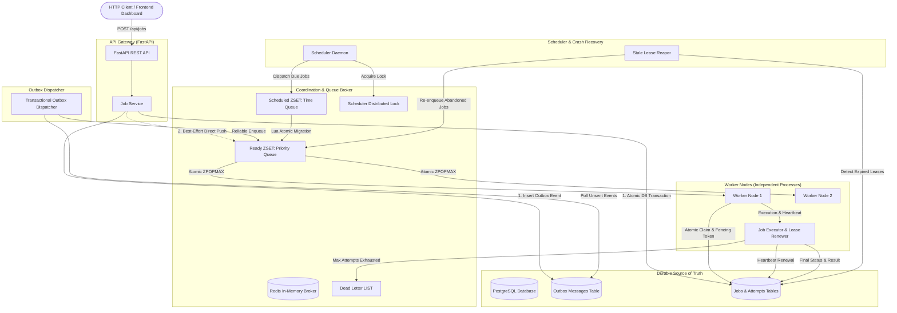

# TaskFlow Architecture & Distributed Systems Design

This document details the architectural decisions, distributed coordination primitives, consistency guarantees, and failure-mode recovery mechanisms implemented in **TaskFlow: Distributed Task Queue & Job Scheduler**.

---

## 1. High-Level System Architecture



---

## 2. Distributed Consistency: The Transactional Outbox Pattern

### The Problem of Dual Writes
A naive implementation writes to PostgreSQL and then writes to Redis:
```python
# ANTI-PATTERN: Dual Write
await db.save(job)
await redis.enqueue(job) # IF THIS FAILS, JOB IS LOST IN THE QUEUE FOREVER
```
If the network partition occurs, Redis crashes, or the process dies after `db.save(job)` but before `redis.enqueue(job)`, the job is persisted in the database as `QUEUED`, but the worker never executes it.

### TaskFlow's Solution
TaskFlow uses the **Transactional Outbox Pattern**:
1. Within an **atomic database transaction**:
   - The `Job` record is persisted with status `PENDING_DISPATCH` (or `SCHEDULED`).
   - An `OutboxMessage` record is created containing the routing topic (`jobs:ready`), job ID, and priority.
   - The transaction commits. PostgreSQL guarantees durability ($ACID$).
2. **Low-Latency Direct Path**: Immediately after DB commit, the API attempts a direct enqueue to Redis. If successful, the outbox record is marked `DISPATCHED` and the job advances to `QUEUED`.
3. **Guaranteed Delivery Safety Net**: An asynchronous `OutboxDispatcher` background loop scans for any `PENDING` outbox records. If the direct Redis call failed due to network glitch or Redis restart, the outbox dispatcher publishes the message and marks it `DISPATCHED`.

This guarantees **at-least-once queue delivery** without dual-write inconsistency.

---

## 3. Priority Ordering & FIFO Tie-Breaking in Redis

TaskFlow implements priority ordering via a Redis Sorted Set (`ZSET`) at `taskflow:queue:ready`.

### Score Calculation Formula
To ensure:
1. Higher priority jobs always pop before lower priority jobs.
2. Jobs with identical priority pop in strict First-In-First-Out (**FIFO**) arrival order.

$$\text{Score} = (\text{Priority} \times 10^{12}) + (10^{10} - \text{Timestamp}_{\text{epoch}})$$

### Mechanics:
- Priority values range from $-100$ to $+100$ (default $0$).
- When $\text{Priority}_A > \text{Priority}_B$, the $10^{12}$ multiplier guarantees $\text{Score}_A > \text{Score}_B$.
- When $\text{Priority}_A = \text{Priority}_B$, the job that arrived earlier ($t_1 < t_2$) has a larger tiebreaker term $(10^{10} - t_1 > 10^{10} - t_2)$, resulting in a higher score.
- Workers claim work using `ZPOPMAX`, yielding strict priority ordering with FIFO tie-breaking.

---

## 4. Distributed Leases & Fencing Tokens (Zombie Worker Protection)

### The Problem of Stale/Zombie Workers
Consider a worker node that claims a job, but experiences a stop-the-world garbage collection pause, high CPU starvation, or network disconnection. If the scheduler detects a timeout and re-assigns the job to a second worker, the first worker might recover and write its stale result back to the database, corrupting state or executing duplicate side effects.

```
Worker 1: Claim Job 1 (attempt 1) -> [GC Pause / Machine Hangs]
Scheduler: Lease Expired! Reassign Job 1 -> Worker 2 (attempt 2)
Worker 2: Succeeded (attempt 2) -> DB updated to SUCCEEDED
Worker 1: Wakes up -> Tries to update DB with stale attempt 1 data!
```

### TaskFlow's Fencing Implementation
1. **Atomic DB Claim with Fencing Token**:
   When a worker claims a job, it generates a cryptographically random UUID `lease_token` and sets `lease_expires_at = now() + 15s`:
   ```sql
   UPDATE jobs
   SET status = 'RUNNING',
       worker_id = :worker_id,
       lease_token = :lease_token,
       lease_expires_at = :expires_at,
       attempt_count = attempt_count + 1
   WHERE id = :job_id
     AND status IN ('QUEUED', 'RETRYING', 'PENDING_DISPATCH');
   ```
   If another worker already claimed the job, `rows_affected == 0`, and the worker safely skips it.

2. **Continuous Heartbeat Renewal**:
   While executing the task handler, a background coroutine renews the lease every 5 seconds:
   ```sql
   UPDATE jobs
   SET lease_expires_at = :new_expiry, updated_at = :now
   WHERE id = :job_id
     AND lease_token = :lease_token
     AND status = 'RUNNING';
   ```

3. **Fenced Finalization**:
   When updating the final job outcome (`SUCCEEDED` or `FAILED`), the query includes the fencing token:
   ```sql
   UPDATE jobs
   SET status = 'SUCCEEDED', result = :result, lease_token = NULL
   WHERE id = :job_id
     AND lease_token = :lease_token
     AND status = 'RUNNING';
   ```
   If the reaper already invalidated this worker's lease, `rows_affected == 0`. The zombie worker's write is rejected, preserving state integrity!

---

## 5. Scheduled Jobs & Lua Atomic Migration

Jobs scheduled for future execution (via `run_at`) are stored in a dedicated Redis ZSET `taskflow:queue:scheduled`, where:
$$\text{Score} = \text{Epoch Seconds of } \text{run\_at}$$

### Atomic Lua Migration
To prevent race conditions where multiple scheduler replicas might pop the same scheduled job simultaneously, migration from `taskflow:queue:scheduled` to `taskflow:queue:ready` is executed inside an atomic Redis Lua script:
```lua
local due_items = redis.call('ZRANGEBYSCORE', KEYS[1], '-inf', ARGV[1], 'LIMIT', 0, ARGV[2])
for _, item in ipairs(due_items) do
    redis.call('ZREM', KEYS[1], item)
    redis.call('ZADD', KEYS[2], score, item)
end
return #due_items
```
Because Redis executes Lua scripts atomically on a single thread, no two scheduler replicas can ever double-dispatch the same scheduled job.

---

## 6. Crash Recovery: The Stale Lease Reaper

If a worker process crashes (`kill -9`, power failure, segfault), its active coroutines terminate instantly and its heartbeats cease.

The `Scheduler` runs a periodic `_reap_stale_leases()` sweep:
1. Queries:
   ```sql
   SELECT * FROM jobs
   WHERE status = 'RUNNING'
     AND lease_expires_at < NOW()
   LIMIT 50;
   ```
2. For each stale job:
   - Records a `JobAttempt` with `status = 'TIMED_OUT'` and error `"Worker lease expired without renewal"`.
   - Checks retry limits:
     - If `attempt_count < max_attempts`: resets status to `QUEUED`, clears `lease_token`, and pushes the job back to the Redis ready queue.
     - If `attempt_count >= max_attempts`: marks status as `FAILED` and routes to `taskflow:queue:dead_letter`.

---

## 7. Retries with Truncated Exponential Backoff & Jitter

When a task fails with a transient exception:
1. Backoff formula:
   $$\text{Delay} = \min\left(\text{MaxDelay}, \text{Base} \times 2^{\text{Attempt} - 1}\right)$$
2. **Jitter Protection**:
   $$\text{Delay}_{\text{jittered}} = \text{Delay} \times \text{Uniform}(0.8, 1.2)$$
   Adding $\pm 20\%$ random jitter desynchronizes retrying workers, preventing downstream services from being overwhelmed by synchronized thundering herds.
3. The job status transitions to `RETRYING` and is placed into the scheduled queue with `run_at = now + delay`.

---

## 8. Delivery Semantics: Why At-Least-Once?

In distributed systems, the **Two Generals' Problem** and network unreliability prove that achieving strictly *exactly-once* execution across distributed processes is theoretically impossible without end-to-end distributed transactions.

TaskFlow provides **At-Least-Once Delivery**:
- A job will be executed 1 or more times in the presence of crashes or network failures.
- **Idempotency Strategy**:
  - API Level: Client-supplied `idempotency_key` ensures duplicate HTTP submissions return the existing job record without re-creating.
  - Handler Level: Task handlers should be written to be idempotent (e.g. using unique transaction IDs or upserts).
